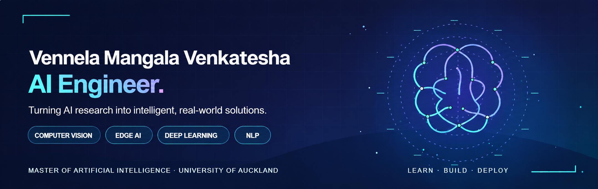
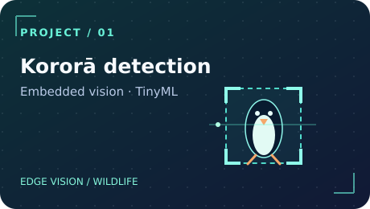
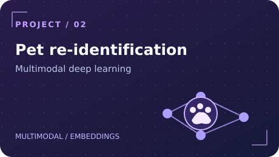
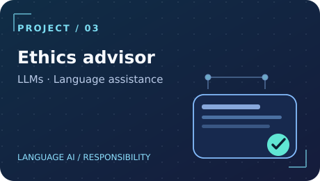

  
    
    

## `01 / About me`

Hi! I'm **Vennela Mangala Venkatesha**, a Master of Artificial Intelligence graduate from the University of Auckland. I enjoy transforming research ideas into practical machine-learning systems, from **model development and evaluation** to **computer vision and resource-constrained AI deployment**.

My work brings together technical depth and real-world purpose, with a particular interest in wildlife protection, trustworthy systems, and applied AI.

## `02 / Featured AI projects`

<table>
  <tr>
    <td width="33%" valign="top">
       
      <b><a href="https://github.com/VennelaMV48/tinyml-korora-dog-detection">Kororā Dog Detection</a></b> 
      Edge AI vision system exploring low-power dog detection near nesting habitats.  
      <code>TinyML</code> <code>Computer Vision</code>
    </td>
    <td width="33%" valign="top">
       
      <b><a href="https://github.com/VennelaMV48/multimodal-pet-reidentification">Multimodal Pet Re-ID</a></b> 
      Exploring multimodal embeddings and deep learning to identify individual pets.  
      <code>Deep Learning</code> <code>Embeddings</code>
    </td>
    <td width="33%" valign="top">
       
      <b><a href="https://github.com/VennelaMV48/llm-animal-ethics-advisor">LLM Animal Ethics Advisor</a></b> 
      Language-assistance tool reviewing clarity and readability in research proposals.  
      <code>LLMs</code> <code>NLP</code>
    </td>
  </tr>
</table>

## `03 / Technical toolkit`

| Focus | Tools and technologies |
| --- | --- |
| **Languages** | Python, SQL, C, C++ |
| **ML / Deep Learning** | PyTorch, TensorFlow, scikit-learn |
| **Computer Vision / Edge** | OpenCV, TinyML, Roboflow, Edge Impulse |
| **Development** | Git, Docker, Linux, Jupyter, Streamlit |
| **Current interests** | Model optimisation, responsible AI, deployment and AI systems |

## `04 / More explorations`

- [Trustworthy Deep Learning](https://github.com/VennelaMV48/trustworthy-deep-learning): fairness, robustness, and explainability.
- [AI Airline Capacity Optimization](https://github.com/VennelaMV48/ai-airline-capacity-optimization): ML for operational planning.
- [AI System Design Experiments](https://github.com/VennelaMV48/ai-system-design-experiments): deep learning and architecture comparisons.

## `05 / Connect`

I'm interested in **AI graduate, machine-learning, computer-vision, and AI engineering opportunities**, especially in New Zealand.

Feel free to explore my repositories or get in touch!

  
  &nbsp;&nbsp;&nbsp;
  

